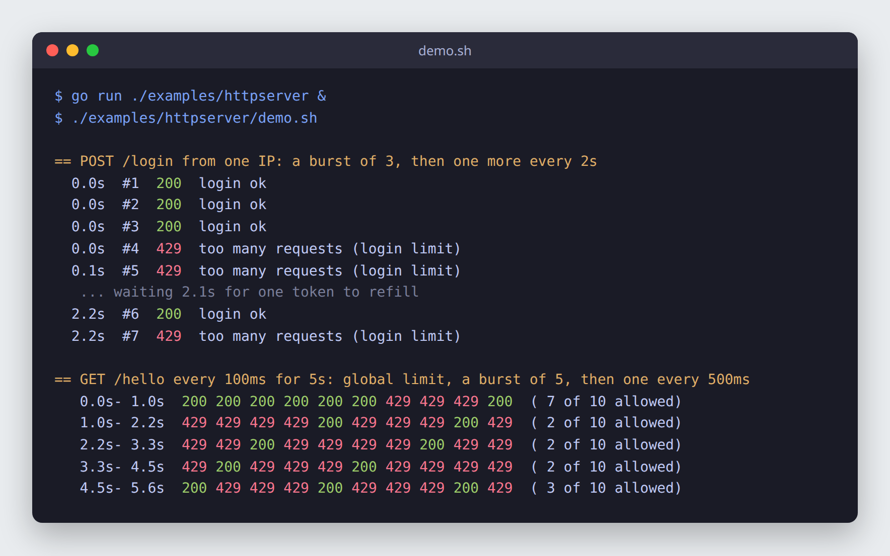
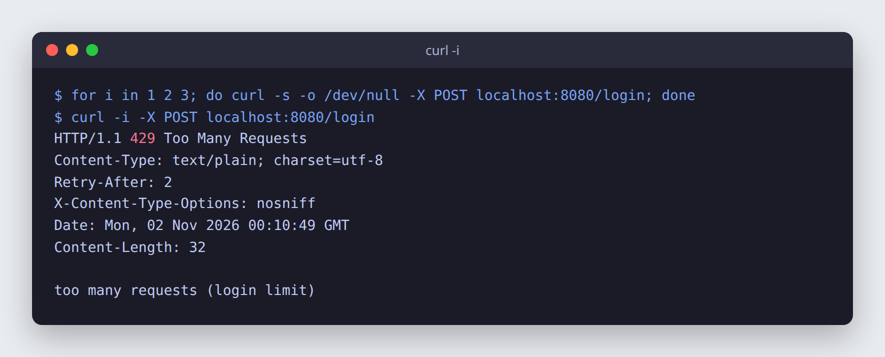
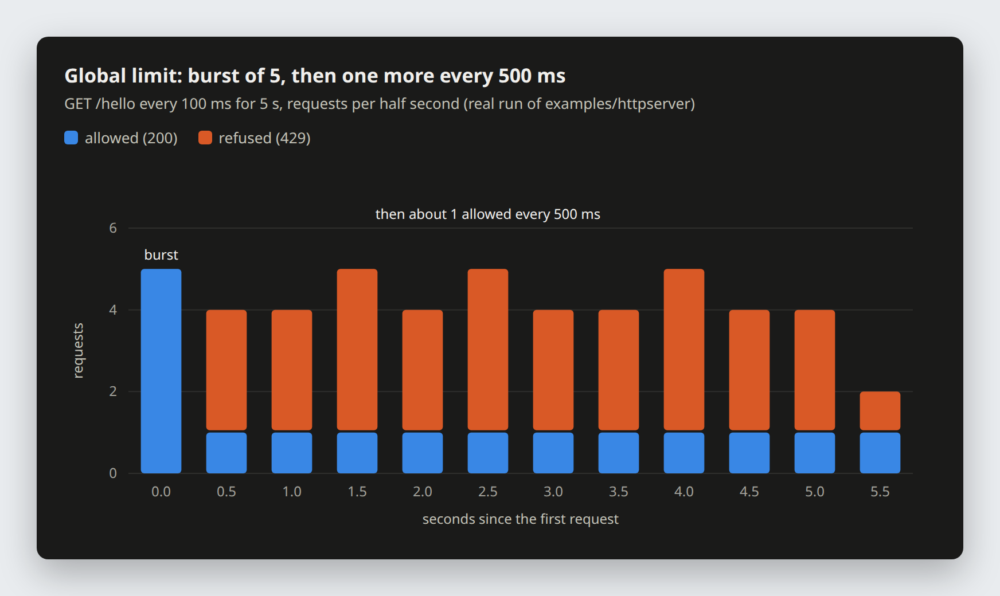

# ratelimit

[](https://pkg.go.dev/github.com/ez-technologies/ratelimit)
[](LICENSE)

A small in-memory rate limiter for Go: one token bucket per key, any number of keys, one call to ask
"may this key act now?". Use it to limit logins per IP, API calls per user, or a whole server, without Redis or any
other service. Built on [`golang.org/x/time/rate`](https://pkg.go.dev/golang.org/x/time/rate).

```go
limits := ratelimit.New(10 * time.Minute)

if !limits.Allow("login:"+ip, 2*time.Second, 3) { // a burst of 3, then one more every 2 seconds
	http.Error(w, "too many requests", http.StatusTooManyRequests)
	return
}
```

## Why

- **A token bucket per key.** Each key (an IP, a user ID, `"global"`, anything) gets its own bucket: a burst of
  `burst` requests, then one more every `every`. Keys never share a budget unless they share a name.
- **Idle keys expire.** A key unused for a while is dropped, so memory follows the active keys rather than every key
  ever seen.
- **A flood of new keys cannot reset a limit in use.** The table is never cleared because it is large. A key is dropped
  only after it has been idle long enough for its bucket to be full again, when forgetting it changes nothing. A
  client that sends requests under thousands of made-up IPs or user names fills the table, but the limit on the key it
  is really after keeps holding.
- **Small.** One type, three methods, safe for concurrent use.

## Install

```sh
go get github.com/ez-technologies/ratelimit
```

## Quick start

```go
package main

import (
	"fmt"
	"time"

	"github.com/ez-technologies/ratelimit"
)

func main() {
	l := ratelimit.New(10 * time.Minute) // forget keys idle for 10 minutes (or a full refill, if longer)

	// Each user: a burst of 5, then one more every second.
	for i := 0; i < 7; i++ {
		fmt.Println(l.Allow("user:42", time.Second, 5))
	}
	// true, true, true, true, true, false, false
}
```

## Screenshots

All three come from real runs of [`examples/httpserver`](examples/httpserver), a `net/http` server with a per-IP limit
on `POST /login` (a burst of 3, then one every 2 s) and a global limit on every route (a burst of 5, then one every
500 ms). Run it yourself:

```sh
go run ./examples/httpserver &
./examples/httpserver/demo.sh
```

**Requests turning into 429s and recovering.** Three logins pass, the fourth and fifth are refused, and after two
seconds one token has refilled, so exactly one more login passes. Below that, `/hello` is called ten times a second
against the global limit: the burst of 5 passes, then about one request in five, matching the refill of one every
500 ms.



**What a refused request looks like.** The example answers `429 Too Many Requests` with a `Retry-After` header of one
refill interval.



**The global limit over time.** The same `/hello` run, counted per half second: the burst is spent in the first half
second, after which one request per half second is allowed and the rest are refused.



## How to

### Limit one route per IP

```go
limits := ratelimit.New(10 * time.Minute)

mux.HandleFunc("POST /login", func(w http.ResponseWriter, r *http.Request) {
	ip, _, _ := net.SplitHostPort(r.RemoteAddr)
	if !limits.Allow("login:"+ip, 2*time.Second, 3) {
		w.Header().Set("Retry-After", "2")
		http.Error(w, "too many requests", http.StatusTooManyRequests)
		return
	}
	// ... check the password
})
```

Behind a reverse proxy, `RemoteAddr` is the proxy. Use the client address the proxy reports instead, and only if you
trust that proxy: a client can put anything in `X-Forwarded-For`.

Prefix keys with the route (`login:`, `reset:`) so that one `Limiter` can hold several limits without them sharing a
bucket.

### Limit per user

Once a request is authenticated, key on the user rather than on the address, so users behind a shared address do not
use up each other's budget, and a user cannot dodge the limit by changing address:

```go
if !limits.Allow("api:user:"+userID, 100*time.Millisecond, 20) { // 20 at once, then 10 a second
	http.Error(w, "too many requests", http.StatusTooManyRequests)
	return
}
```

### A global limit

A fixed key is one bucket shared by every caller, which caps the whole process, for example the calls it makes to a
paid or fragile upstream service:

```go
if !limits.Allow("global:upstream", 50*time.Millisecond, 40) { // 20 a second, bursts of 40
	return errBusy
}
```

Per-key and global limits combine: check both, and a request must pass each one.

### Choose `every` and `burst`

- `every` is the steady rate: one request per `every`, so `every = time.Minute / n` allows `n` a minute.
- `burst` is how many may come at once after a quiet period (the size of the bucket). It must be at least 1.
- Pick the steady rate an honest client needs, then a burst that covers a normal flurry (a page that makes several
  calls, a user retyping a password). For logins, a small burst and a slow refill (3, then one every 2 s or slower)
  make guessing expensive; for an API, a larger burst keeps clients that batch their calls working.
- The first `Allow` for a key fixes its rate and burst. Later calls for the same key with other values use the first
  ones, so always pass the same values for a key (constants help), and use a different key for a different limit.

| Limit | `every` | `burst` |
|---|---|---|
| 5 logins a minute per IP, no more than 3 at once | `12 * time.Second` | `3` |
| 10 requests a second per user, bursts of 20 | `100 * time.Millisecond` | `20` |
| 1000 requests a minute for the whole server | `60 * time.Millisecond` | `100` |

### Middleware for net/http

```go
// PerIP limits every request a handler gets by client IP.
func PerIP(limits *ratelimit.Limiter, every time.Duration, burst int, next http.Handler) http.Handler {
	return http.HandlerFunc(func(w http.ResponseWriter, r *http.Request) {
		ip, _, err := net.SplitHostPort(r.RemoteAddr)
		if err != nil {
			ip = r.RemoteAddr
		}
		if !limits.Allow("ip:"+ip, every, burst) {
			w.Header().Set("Retry-After", strconv.Itoa(int(math.Ceil(every.Seconds()))))
			http.Error(w, "too many requests", http.StatusTooManyRequests)
			return
		}
		next.ServeHTTP(w, r)
	})
}

// handler := PerIP(limits, time.Second, 10, mux)
```

[`examples/httpserver`](examples/httpserver/main.go) is a complete server with a global middleware and a per-route
limit.

### Middleware for Gin

This library does not depend on Gin; the middleware is a few lines in your own code:

```go
import (
	"net/http"
	"time"

	"github.com/ez-technologies/ratelimit"
	"github.com/gin-gonic/gin"
)

func RateLimit(limits *ratelimit.Limiter, prefix string, every time.Duration, burst int) gin.HandlerFunc {
	return func(c *gin.Context) {
		if !limits.Allow(prefix+c.ClientIP(), every, burst) {
			c.AbortWithStatusJSON(http.StatusTooManyRequests, gin.H{"error": "too many requests"})
			return
		}
		c.Next()
	}
}

// r.POST("/login", RateLimit(limits, "login:", 2*time.Second, 3), loginHandler)
```

`c.ClientIP()` trusts forwarding headers from any address until you call `SetTrustedProxies`; set it to your real
proxies (or `nil`) so a client cannot choose its own key.

### Several instances

Limits live in the memory of one process. With several instances behind a load balancer each one counts on its own,
so the real ceiling is the limit times the number of instances, and a restart forgets every bucket. Divide the limit
by the number of instances, send each client to the same instance (sticky sessions), or use a shared store such as
Redis when the limit must hold exactly across instances.

## API

Full documentation: [pkg.go.dev/github.com/ez-technologies/ratelimit](https://pkg.go.dev/github.com/ez-technologies/ratelimit).

```go
func New(idle time.Duration) *Limiter
```

Makes a `Limiter`. A key is forgotten once it has been unused for `idle`, or for as long as its bucket takes to refill
completely (`every * burst`) if that is longer. Idle keys are swept during `Allow`, at most once a minute (or once per
`idle` when that is shorter).

```go
func (l *Limiter) Allow(key string, every time.Duration, burst int) bool
```

Reports whether `key` may act now and, if so, takes one token from its bucket: a burst of `burst`, then one more every
`every`. A new key starts with a full bucket. The first call for a key fixes its rate; later calls with other values
for the same key use the first ones.

```go
func (l *Limiter) Len() int
```

The number of keys held, including idle ones not swept yet.

A `Limiter` is safe for concurrent use by many goroutines; share one per process.

## Tests

```sh
go test ./...
```

The tests use a fake clock, so they run in milliseconds. They cover a burst followed by refusals and a refill,
separate buckets per key, idle keys expiring while a slow-refilling key survives, and 20,000 made-up keys failing to
reset a limit in use.

## Licence

MIT, see [LICENSE](LICENSE).
